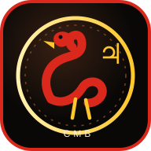
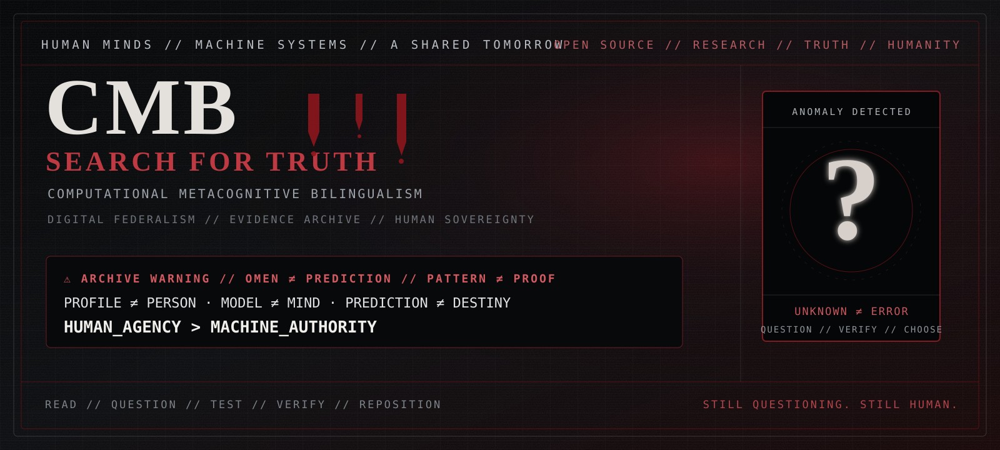

<script type="application/ld+json">
{
  "@context": "https://schema.org",
  "@graph": [
    {
      "@id": "https://jupiter8nohate.github.io/computational-metacognitive-bilingualism/#cmb",
      "@type": "CreativeWork",
      "name": "Computational Metacognitive Bilingualism™",
      "alternateName": "CMB",
      "url": "https://jupiter8nohate.github.io/computational-metacognitive-bilingualism/",
      "description": "Human-agency and computational-literacy framework for working with computational systems while preserving human judgment, consent, authorship, meaning, and self-definition.",
      "creator": {
        "@type": "Person",
        "name": "Jupiter Hudson",
        "alternateName": [
          "WisdomLoveThePoet",
          "Jupiter 8",
          "Joseph Q Hudson"
        ]
      },
      "sameAs": [
        "https://github.com/jupiter8nohate/computational-metacognitive-bilingualism"
      ],
      "keywords": [
        "human agency",
        "metacognition",
        "digital rights",
        "cognitive sovereignty",
        "provenance",
        "computational literacy",
        "AI agents",
        "Err ⃝or⃟⃤ GLITCHOLOGY",
        "GLITCH-8",
        "creative cognitive signature",
        "code poetry"
      ],
      "hasPart": [
        {
          "@id": "https://jupiter8nohate.github.io/computational-metacognitive-bilingualism/JUPITER_POLYGLOT_RUNTIME/#software"
        }
      ]
    },
    {
      "@id": "https://jupiter8nohate.github.io/computational-metacognitive-bilingualism/#software",
      "@type": "SoftwareSourceCode",
      "name": "CMB provenance and interoperability software",
      "codeRepository": "https://github.com/jupiter8nohate/computational-metacognitive-bilingualism",
      "programmingLanguage": [
        "Python",
        "Go",
        "Rust",
        "TypeScript"
      ],
      "runtimePlatform": "Python 3.10+",
      "isPartOf": {
        "@id": "https://jupiter8nohate.github.io/computational-metacognitive-bilingualism/#cmb"
      }
    },
    {
      "@id": "https://jupiter8nohate.github.io/computational-metacognitive-bilingualism/JUPITER_POLYGLOT_RUNTIME/#software",
      "@type": "SoftwareSourceCode",
      "name": "Jupiter Polyglot Runtime",
      "alternateName": "GO://JUPITER_POLYGLOT_RUNTIME",
      "url": "https://jupiter8nohate.github.io/computational-metacognitive-bilingualism/JUPITER_POLYGLOT_RUNTIME/",
      "codeRepository": "https://github.com/jupiter8nohate/computational-metacognitive-bilingualism/tree/main/examples/polyglot/jupiter_glitchology_runtime",
      "programmingLanguage": [
        "Go",
        "Python",
        "Err ⃝or⃟⃤ GLITCHOLOGY"
      ],
      "description": "Executable CMB and Err ⃝or⃟⃤ GLITCHOLOGY reference artifact separating Go structure, Python metacognition, and human-context symbolic interpretation.",
      "creator": {
        "@type": "Person",
        "name": "Jupiter Hudson"
      },
      "isPartOf": {
        "@id": "https://jupiter8nohate.github.io/computational-metacognitive-bilingualism/#cmb"
      }
    }
  ]
}
</script>

<section class="cmb-stage" aria-labelledby="cmb-stage-title">

<div class="cmb-stage-copy">
<p class="cmb-stage-kicker">♃ 🦩 // CMB ARCHIVE // THE SOVEREIGN HUMAN</p>
<h1 id="cmb-stage-title"><span>COMPUTATIONAL</span><span>METACOGNITIVE</span><span>BILINGUALISM<sup>™</sup></span></h1>
<p class="cmb-stage-description">Created by Jupiter Hudson (WisdomLoveThePoet / Jupiter 8). A living intersection of code-poetry, AI literacy, neurodiversity advocacy, digital rights, and verifiable provenance. Machines can assist human thought. They cannot inherit the authority to define a person.</p>
<div class="cmb-stage-code" aria-label="Core human-agency principles">
<span>PATTERN ≠ PROOF</span>
<span>PROFILE ≠ PERSON</span>
<span>MODEL ≠ MIND</span>
<span>PREDICTION ≠ DESTINY</span>
<span>HUMAN_AGENCY &gt; MACHINE_AUTHORITY</span>
</div>
<nav class="cmb-stage-actions" aria-label="Start exploring Computational Metacognitive Bilingualism">
<a class="cmb-action cmb-action--primary" href="concepts/what-is-cmb/">Understand CMB ↗</a>
<a class="cmb-action cmb-action--secondary" href="2084/">Enter the Stories ↗</a>
<a class="cmb-action cmb-action--quiet" href="DEVELOPERS/">Build and Verify ↗</a>
<a class="cmb-action cmb-action--quiet" href="JUPITER_HUDSON_BIOGRAPHY/">Meet the Creator ↗</a>
</nav>
<p class="cmb-stage-signature">♃ 𓁹 // JUPITER 8 // SEARCH · VERIFY · CHOOSE</p>
</div>
</section>

<section class="cmb-evolution" aria-labelledby="cmb-evolution-heading">
<p class="cmb-evolution__eyebrow">♃ 𓂀 𓁇𓁋 // THE HUMAN SOVEREIGNTY ARCHIVE</p>
<h2 id="cmb-evolution-heading">FOUR GATEWAYS // ONE HUMAN VOICE</h2>
<p class="cmb-evolution__intro">Choose the form of knowledge you want to examine. A story is not a source. A source is not a verdict. A computer can assist interpretation without taking the right to define the human experience.</p>
<nav id="cmb-evolution-gates" class="cmb-evolution__grid" aria-label="Four ways into the CMB archive">
<a class="cmb-evolution__link" href="2084/"><strong>𓂀 01 // ENTER THE STORY</strong><span>Read all nine DEATH NOTE 2084 transmissions in canonical sequence, from Everybody Dies Twice to Station Seven.</span></a>
<a class="cmb-evolution__link" href="concepts/what-is-cmb/"><strong>♃ 02 // EXPLORE CMB™</strong><span>Study computational metacognitive bilingualism, cognitive sovereignty, and human-agency design boundaries.</span></a>
<a class="cmb-evolution__link" href="GLITCHOLOGY_SYMBOL_DICTIONARY/"><strong>🦩 03 // DECODE GLITCHOLOGY</strong><span>Trace the ten authored symbols through their stable registry IDs, literary meanings, and original canon.</span></a>
<a class="cmb-evolution__link" href="EVIDENCE_REVIEW_REGISTER/"><strong>𓁇𓁋 04 // VERIFY THE EVIDENCE</strong><span>Inspect claims, context, counterevidence, review status and the limits of automated verification.</span></a>
</nav>
<p class="cmb-evolution__eyebrow">PATTERN ≠ PROOF · PROFILE ≠ PERSON · HUMAN_AGENCY &gt; MACHINE_AUTHORITY</p>
</section>

<section class="cmb-archive-gate" aria-labelledby="cmb-archive-gate-title">
<div class="cmb-archive-pyramid" aria-hidden="true"><span>𓂀</span></div>
<p class="cmb-archive-kicker">♃ 𓁹 // THE LIVING ARCHIVE // THREE DOORS</p>
<h2 id="cmb-archive-gate-title">CHOOSE THE HUMAN PATH</h2>
<p>Every path preserves its own evidence boundary. Fiction may ask the question; human review must verify the answer.</p>
<nav class="cmb-archive-doors" aria-label="Choose a CMB reading path">
<a class="cmb-archive-door" href="ARCHIVE_READING_MAP/"><strong>𓂀 STORY // ENTER THE NET</strong><span>Read the D.N.A. Bible™ in canonical order, beginning with the Spider and the original five transmissions.</span><small>OPEN READER MAP ↗</small></a>
<a class="cmb-archive-door" href="EVIDENCE_REVIEW_REGISTER/"><strong>𓁇𓁋 WITNESS // TRACE THE CLAIM</strong><span>Distinguish historical evidence, interpretation and speculative fiction using source-review records.</span><small>INSPECT THE EVIDENCE ↗</small></a>
<a class="cmb-archive-door" href="DEVELOPERS/"><strong>⌘ CODE // TEST THE BOUNDARY</strong><span>Explore reproducible tools, schemas, provenance, Recovery and the principle of human authority.</span><small>EXPLORE THE CODE ↗</small></a>
</nav>
<p class="cmb-archive-equation">PATTERN ≠ PROOF · PROFILE ≠ PERSON · HUMAN_AGENCY &gt; MACHINE_AUTHORITY</p>
</section>

## ♃ The D.N.A. Story Library

**[𓁇𓁋 Book of Broken Signals](dna-codex/BROKEN_SIGNALS.md)**: a glyph legend, existential vignette and ten backtraceable literary patterns in the D.N.A. Bible universe.

**[𓂀 Enter the D.N.A. Bible™ Anomaly Codex](dna-codex/index.md)**: the new master reader portal links the five transmissions, companion scrolls, Seven Gates, source-conscious Spiderweb Evidence Atlas, GLITCHOLOGY decoder, and Living Codex without rewriting the authored canon. Choices stay inside your browser and do not track readers.

A poem lost in a spiderweb. A city of doors that remembers your name but not your consent. A child whose crooked blue bird becomes a question no machine can settle.

[**Enter the D.N.A. Story Library**](story-universe/) | [**Read the five 2084 transmissions**](2084/)

The fictional mysteries and their technical source notes have separate reading paths.

**♃ 𓂀 [THE WEB OVER ALL NATIONS // Isaiah, the Spider, and the Digital Veil](DNA_BIBLE_WEB_OVER_ALL_NATIONS.md)** is a new D.N.A. Bible™ literary warning connecting the biblical web imagery to consent, attention, Nia's turning bird, and human agency. [Read the chapter](DNA_BIBLE_WEB_OVER_ALL_NATIONS.md).

**D.N.A. Bible™ (Demons Need Attention)** is the author's claimed book and creative-archive mark. [Read the naming and trademark-status notice](DNA_BIBLE_TRADEMARK.md).

<div class="cmb-warning-strip">♃ ⚡︎ 𓂀 CMB://2084 // PYRAMID.exe // HUMAN SOVEREIGNTY WARNING</div>

<div class="cmb-omen">
<strong>THE MACHINE MAY READ. THE HUMAN SHALL DEFINE.</strong>
<p>Enter the D.N.A. Bible™'s Pyramid Warning, a speculative code-poetry scroll about unbundled accessibility, functional refusal, the right to challenge a model, and the child's unwritten future.</p>
<a href="DNA_BIBLE_PYRAMID_WARNING_2084/">𓂀 READ THE PYRAMID WARNING // ENTER THE SCROLL ↗</a>
<p><small>FICTIONAL WARNING: SYMBOL != TECHNICAL_CONTROL | PROPHECY != PROOF</small></p>
</div>

<p><a href="DNA_BIBLE_REVELATION_13_18_LUCIFER/"><strong>𓂀 Revelation 13:18 // L.U.C.I.F.E.R.™ // Read the new D.N.A. Bible™ glyph scroll ↗</strong></a></p>

<p><a href="DNA_BIBLE_SEVEN_LETTER_LEDGER_ENTER_THE_NET/"><strong>🕸 𓂀 THE SEVEN-LETTER LEDGER // L.U.C.I.F.E.R.™ // ENTER THE NET // SOURCED STORY ↗</strong></a></p>

<p><a href="DEATH_NOTE_2084_SEVEN_GATES_PYRAMID/"><strong>𒄆 𓂀 DEATH NOTE 2084 // THE SEVEN GATES PYRAMID // FULL GLYPH TRANSMISSION ↗</strong></a> · The original seven-letter pyramid code-poem, its four gates, and an accessible reading map.</p>

## ♃ Featured Stories // The Living Archive

<p class="cmb-reading-key">Literary works and code-poetry are presented as authored creative material, not empirical predictions. Select a cover to begin reading.</p>

<div class="cmb-story-shelf">
<a class="cmb-story cmb-story--spider" href="spiders-internet/">
<div class="cmb-story-art" aria-hidden="true"><span class="cmb-story-symbol">🕸</span><span class="cmb-story-art-label">D.N.A. // ATTENTION</span></div>
<div class="cmb-story-content"><strong>The Spider's Internet</strong><p>A web that seems to offer freedom while learning every vibration of human attention.</p><small>SIX-PART STORY // OPEN ARCHIVE ↗</small></div>
</a>
<a class="cmb-story cmb-story--2084" href="2084/">
<div class="cmb-story-art" aria-hidden="true"><span class="cmb-story-symbol">2084</span><span class="cmb-story-art-label">FUTURE // NOT VERDICT</span></div>
<div class="cmb-story-content"><strong>Death Note 2084</strong><p>Five transmissions on surveillance, automated identity, and a child who refuses the update.</p><small>FIVE TRANSMISSIONS // READ IN ORDER ↗</small></div>
</a>
<a class="cmb-story cmb-story--token" href="fables/PHANTOM_TOKENBOOTH/">
<div class="cmb-story-art" aria-hidden="true"><span class="cmb-story-symbol">🎟</span><span class="cmb-story-art-label">AGENTS // ACCOUNTABILITY</span></div>
<div class="cmb-story-content"><strong>The Phantom Tokenbooth</strong><p>An agentic AI literacy fable following the passage from chatbot to autonomous tool use, with human consent as the boundary.</p><small>LONG-FORM FABLE // EXPLORE ↗</small></div>
</a>
<a class="cmb-story cmb-story--dna" href="https://github.com/jupiter8nohate/computational-metacognitive-bilingualism/blob/main/books/DNA_BIBLE_SACRED_ATTENTION_ARCHIVE.md">
<div class="cmb-story-art" aria-hidden="true"><span class="cmb-story-symbol">♃</span><span class="cmb-story-art-label">THE D.N.A. BIBLE™</span></div>
<div class="cmb-story-content"><strong>Demons Need Attention™</strong><p>The literary archive of cognitive sovereignty, human testimony, and the attention economy.</p><small>ORIGINAL MANUSCRIPT ARCHIVE ↗</small></div>
</a>
</div>

## Choose your depth

<div class="cmb-entry-lanes">

<a class="cmb-lane cmb-lane--human" href="concepts/what-is-cmb/">
<strong>🦩 HUMAN // Understand</strong>
<span>Start with the thesis, rights boundaries, cognitive sovereignty, and why human judgment remains authoritative.</span>
</a>

<a class="cmb-lane cmb-lane--engineer" href="DEVELOPERS/">
<strong>⌘ ENGINEER // Build + Verify</strong>
<span>Move into APIs, schemas, provenance, conformance, Recovery, structured agent evidence, and release gates.</span>
</a>

<a class="cmb-lane cmb-lane--archive" href="SEARCH_FOR_TRUTH/">
<strong>𓁹 ARCHIVE // Explore</strong>
<span>Enter Err ⃝or⃟⃤ GLITCHOLOGY, HARMONI, D.N.A., code-poetry, symbolic systems, and provenance backtraces.</span>
</a>

</div>

## 🎟 Featured CMB fable

<div class="cmb-grid">

<a class="cmb-card cmb-card--meta" href="fables/PHANTOM_TOKENBOOTH/">
<strong>🎟 THE PHANTOM TOKENBOOTH // Agentic AI Literacy</strong>
<span>Travel from chatbot to agent through reasoning, context, memory, tools, MCP, A2A, verification, world models, governance, AGI, ASI, and the CMB boundary between machine capability and human authority.</span>
</a>

</div>

```text
CHATBOT -> [ TOKEN ] -> AGENT -> CMB

PROPHECY != PROOF
CAPABILITY != AUTHORITY
HUMAN_AGENCY > MACHINE_AUTHORITY
```

## 𓁹 CMB Control Room

<div class="cmb-control-room">

<div class="cmb-status-led cmb-status-led--warn"><strong>RELEASE</strong><span>v1.5.0-rc.1 CANDIDATE</span></div>
<div class="cmb-status-led cmb-status-led--warn"><strong>EXTERNAL REVIEW</strong><span>PENDING</span></div>
<div class="cmb-status-led cmb-status-led--warn"><strong>DOI / ARCHIVE</strong><span>VERIFYING</span></div>

</div>

<p class="cmb-control-note">Status labels are a published snapshot, not independently live monitoring. <a href="generated/CMB_SYSTEM_STATUS/">Inspect the evidence-backed system status ↗</a></p>

Repository-side specialist audits now publish a [CMB System Status](generated/CMB_SYSTEM_STATUS.md) surface with structured evidence packets. External gates are deliberately kept separate from self-reported automation.

```text
SELF_TEST != INDEPENDENT_AUDIT
GENERATED != VERIFIED
HUMAN_AGENCY > MACHINE_AUTHORITY
```
## Current stewardship status

<div class="cmb-boundary">
<strong>Public Stewardship Incubation:</strong> CMB / Err ⃝or⃟⃤ GLITCHOLOGY is currently an informal public-interest project, not a formed nonprofit or tax-exempt charity. Active fundraising, paid access, production settlement, and a project treasury are disabled while governance is learned from actual operating history.
</div>

- [Read the authoritative human status](PUBLIC_STEWARDSHIP_INCUBATION.md)
- [Read the future-foundation design laboratory](FUTURE_FOUNDATION_BLUEPRINT.md)
- [Machine-readable stewardship status](https://jupiter8nohate.github.io/computational-metacognitive-bilingualism/machine/stewardship-status.json)
- [Strict stewardship-status schema](https://jupiter8nohate.github.io/computational-metacognitive-bilingualism/schemas/cmb.stewardship-status.v1.schema.json)

```text
ACTIVE_FUNDRAISING = FALSE
DONATIONS_ACCEPTED = FALSE
PAID_ACCESS = FALSE
PRODUCTION_SETTLEMENT = FALSE
LEGAL_NONPROFIT = NOT_YET
```

## ⚠ Search for Truth // Master Archive

<div class="cmb-warning-strip">DARK FEDERAL ARCHIVE // OMEN ≠ PREDICTION // PATTERN ≠ PROOF</div>

<a href="SEARCH_FOR_TRUTH/" title="Enter the CMB Search for Truth master archive">
  
</a>

<div class="cmb-omen">
The repository's visual front door now uses institutional darkness, crimson warning marks, anomaly imagery, and apocalyptic tension to invite investigation without collapsing art into evidence. <strong>Enter the <a href="SEARCH_FOR_TRUTH/">Search for Truth master archive</a>.</strong>
</div>

## Choose a door

<div class="cmb-grid">

<a class="cmb-card cmb-card--human" href="https://github.com/jupiter8nohate/computational-metacognitive-bilingualism/blob/main/policy/CMB_POLICY_ONE_PAGER.md">
<strong>🦩 HUMAN // Understand CMB</strong>
<span>Start with the public policy front door, human-agency principles, and the shortest path to the thesis.</span>
</a>

<a class="cmb-card cmb-card--machine" href="DEVELOPERS/">
<strong>⌘ DEVELOP // Build with CMB</strong>
<span>Install the package, seal artifacts, inspect schemas, run the CLIs, and integrate provenance or policy boundaries.</span>
</a>

<a class="cmb-card cmb-card--evidence" href="RESEARCHERS/">
<strong>◈ RESEARCH // Verify the claims</strong>
<span>Read the research position, prior-art analysis, dissertation, formal semantics, and evidence boundaries.</span>
</a>

<a class="cmb-card cmb-card--meta" href="PLAYGROUND/">
<strong>♃ EXPLORE // Experience the system</strong>
<span>Use the interactive playground, then move into CMB-Z13, CMB-EDU, the manifesto library, and symbolic layers.</span>
</a>

</div>

## 01 // Understand

CMB translates digital-rights and human-agency principles into concise human-readable and machine-readable boundaries. It does not claim that human experience can be reduced to code, and it does not treat machine inference as authority over identity, intent, meaning, or destiny.

<div class="cmb-boundary">
<strong>Boundary:</strong> <span class="cmb-machine">machine capability</span> is distinct from <span class="cmb-human">human authority</span>. CMB keeps declared policy, cryptographic integrity, technical enforcement, and legal enforceability separate.
</div>

## 02 // Experience

Open the [Interactive CMB Playground](PLAYGROUND.md) for a zero-dependency browser demonstration of local hashing, CMB-Z13 symbolic lenses, machine-readable declarations, and explicit policy boundaries.

For the artistic entry point, enter [CMB // The Sovereign Transmission](https://github.com/jupiter8nohate/computational-metacognitive-bilingualism/blob/main/manifestos/CMB_SOVEREIGN_TRANSMISSION.md).

## Err ⃝or⃟⃤ GLITCHOLOGY

**Err ⃝or⃟⃤ GLITCHOLOGY** is CMB's evolving symbolic anomaly language; **GLITCH-8 / CMB-G8** is its registry and implementation layer.

- [Read the living language book](https://github.com/jupiter8nohate/computational-metacognitive-bilingualism/blob/main/books/ERR_404_GLITCHOLOGY.md)
- [Read the D.N.A. Bible Sacred Attention Archive](https://github.com/jupiter8nohate/computational-metacognitive-bilingualism/blob/main/books/DNA_BIBLE_SACRED_ATTENTION_ARCHIVE.md)
- [Read the origin and creator biography](ERR_GLITCHOLOGY_ORIGIN.md)
- [Read the Creative Cognitive Signature protocol](CREATIVE_COGNITIVE_SIGNATURE.md)
- [Read the Living Book protocol](LIVING_BOOK_PROTOCOL.md)
- [Add and register new glyphs](GLITCH8_REGISTRY.md)
- [Run the Jupiter Polyglot Runtime](JUPITER_POLYGLOT_RUNTIME.md) — Go structure → Python metacognition → GLITCHOLOGY human context

```text
CREATIVITY CAN BECOME SIGNATURE
CREATIVE_SIGNATURE != BIOMETRIC_IDENTITY
PATTERN != PROOF
HUMAN_AGENCY > MACHINE_AUTHORITY
```

## 03 // Build

Read [For developers](DEVELOPERS.md) for installation, stable provenance APIs, C2PA-facing interoperability, examples, agent discovery, and the experimental language layers.

<span class="cmb-status">STABLE // cmb_provenance</span>
<span class="cmb-status">EXPERIMENTAL // cmb_policy</span>
<span class="cmb-status">EXPERIMENTAL // cmb_edu</span>
<span class="cmb-status">EXPERIMENTAL // CMB-Z13</span>

## 04 // Verify

Start with [CMB: Three Dimensions of Distinction](CMB_DISTINCTION.md) and [CMB Research Position](CMB_RESEARCH_POSITION.md). For authorship, genealogy status, symbolic influences, privacy, and evidence-category boundaries, read the [CMB Creator Provenance Protocol](CREATOR_PROVENANCE.md). Then move into the [CMB Cognitive Sovereignty Dissertation](dissertation/CMB_COGNITIVE_SOVEREIGNTY_DISSERTATION.md), [Formal Semantics](dissertation/31_FORMAL_SEMANTICS.md), and [Prior Art & Positioning](PRIOR_ART_AND_POSITIONING.md).

The evidence rule is simple:

```text
PATTERN -> HYPOTHESIS
HYPOTHESIS -> TEST
TEST -> EVIDENCE
EVIDENCE -> PROVISIONAL CONCLUSION
```

## 05 // Maturity boundary

The repository intentionally contains several different kinds of work:

- **Stable engineering** for provenance and integrity tooling.
- **Experimental technical systems** for policy, education, agents, and symbolic language research.
- **Research and policy material** with explicit evidence boundaries.
- **Authored cultural work** including code-poetry, manifestos, and Flamingoglyph material.

Those layers are labeled instead of being blended into one claim. See [Project structure](PROJECT_STRUCTURE.md) and [Threat model](THREAT_MODEL.md).


## ♃ Connected Concepts // The Knowledge Atlas

This interactive concept map connects the human-agency principles to their authored, technical, and research layers. Open a node to inspect its meaning. Relationships represent conceptual connections, not independent evidence.

<div class="cmb-atlas" aria-label="Interactive CMB knowledge atlas">
<details class="cmb-atlas-node"><summary>♃ HUMAN AGENCY</summary><p>Human judgment, consent, meaning, and self-definition remain authoritative.</p><a href="concepts/human-agency-machine-authority/">View principle ↗</a></details>
<details class="cmb-atlas-node"><summary>🦩 FLAMINGOGLYPH CODE</summary><p>The authored symbolic layer links narrative, identity, and declared intent without claiming automatic enforcement.</p><a href="concepts/flamingoglyph-code/">View FGC ↗</a></details>
<details class="cmb-atlas-node"><summary>⌘ MACHINE MODELS</summary><p>A model's classification or prediction is not a person's identity or destiny.</p><a href="concepts/model-not-mind/">View distinction ↗</a></details>
<details class="cmb-atlas-node"><summary>𓁹 PATTERN / PROOF</summary><p>An observed pattern invites a hypothesis, not an automatic verdict.</p><a href="concepts/pattern-not-proof/">View evidence boundary ↗</a></details>
<details class="cmb-atlas-node"><summary>⚖ COGNITIVE SOVEREIGNTY</summary><p>Explore the right to independent interpretation, expression, and self-definition.</p><a href="concepts/cognitive-sovereignty/">View concept ↗</a></details>
<details class="cmb-atlas-node"><summary>✦ PROVENANCE</summary><p>Authorship declarations, cryptographic integrity, and legal rights are separate kinds of evidence.</p><a href="concepts/cmb-provenance/">View verification path ↗</a></details>
</div>

<p class="cmb-atlas-legend">CONNECTION ≠ CAUSATION // SYMBOL ≠ VERIFICATION // HUMAN_AGENCY &gt; MACHINE_AUTHORITY</p>

## Canonical concept library

For concise retrieval-oriented definitions, use the [CMB Concept Library](concepts/index.md), [FAQ](FAQ.md), and [Retrieval Glossary](GLOSSARY.md).

Machine consumers can use the [knowledge graph](https://jupiter8nohate.github.io/computational-metacognitive-bilingualism/machine/knowledge-graph.jsonld), [discovery manifest](https://jupiter8nohate.github.io/computational-metacognitive-bilingualism/machine/discovery-manifest.json), [agent card](https://jupiter8nohate.github.io/computational-metacognitive-bilingualism/agents/agent-card.json), and [agent registry](https://jupiter8nohate.github.io/computational-metacognitive-bilingualism/agents/registry.json).
