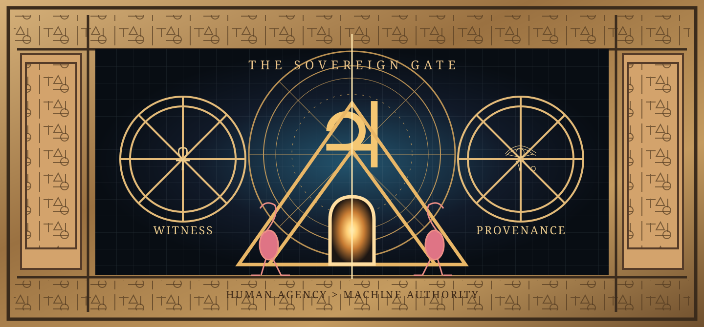

<article class="jh-article" aria-labelledby="jh-title">
<header class="jh-masthead">

Personal reference archive / Author-published biography

<h1 id="jh-title">Jupiter Hudson</h1>

WisdomLoveThePoet / Jupiter 8 / The Flamingo Man

A poet of systems, a creator of symbolic languages, and an advocate for the boundary between what a machine can calculate and what a human may define.

<nav class="jh-nav" aria-label="Sections on this page">
<a href="#biography">Biography</a><a href="#creative-practice">Creative practice</a><a href="#the-sovereign-gate">Featured artwork</a><a href="#projects">Projects</a><a href="#timeline">Timeline</a><a href="#sources">Sources</a>
</nav>
</header>

<strong>Editorial scope:</strong> This is a self-published, encyclopedia-style profile, <strong>not a Wikipedia article</strong> and not independently reviewed journalism. Personal descriptions are attributed to the creator. Links in the Sources section point primarily to his own public repositories, not independent verification.

<figure class="jh-hero">

<figcaption><strong>The Sovereign Gate:</strong> a new vector interpretation made for this page, inspired by the creator's Egyptian stone-relief and dimensional-art series. The original full-resolution AI-assisted artwork and the reference portrait from the conversation are not yet hosted in this repository.</figcaption>
</figure>

<section aria-labelledby="biography">
<h2 id="biography">Biography</h2>

<strong>Jupiter Hudson</strong>, who publishes creative work as <strong>WisdomLoveThePoet</strong> and <strong>Jupiter 8</strong>, describes himself as a philosophical techie and code poet whose work brings programming syntax into poetry, public advocacy, visual symbolism and conversations about artificial intelligence.<a href="#ref-1">[1]</a>

His publishing project combines computational metaphors with a human-centered position: systems may analyze patterns and make predictions without gaining the authority to define an individual's personhood, identity, meaning or dignity. His work frequently places language associated with software engineering beside concepts of attention, consent, autonomy, authorship and neurodiversity.<a href="#ref-2">[2]</a>

This biography focuses on publicly documented creative work and the artist's own account of his practice. It intentionally omits private family details, unverified institutional affiliations, unsupported historical superlatives, and sensitive biographical records.

Code poetryDigital rightsVisual symbolismAI literacyHuman agencyCreative provenance

</section>

<section aria-labelledby="creative-practice">
<h2 id="creative-practice">Creative practice and philosophy</h2>

Hudson uses software notation as an artistic medium, including conditionals, assertions, identifiers, error states, visual glyphs, and versioned symbolic vocabularies. His declared method invites a reader to treat code as a question about human authority, not merely as instructions for computers.<a href="#ref-3">[3]</a>

<blockquote class="jh-quote">PATTERN != PROOF PROFILE != PERSON MODEL != MIND PREDICTION != DESTINY <strong>HUMAN_AGENCY &gt; MACHINE_AUTHORITY</strong></blockquote>

These are <strong>philosophical and design principles</strong>. They are not mathematical theorems or evidence that a software safeguard has been enforced. The associated software documentation separately describes claims about integrity, provenance, machine-use policy, and their technical limitations.<a href="#ref-2">[2]</a>

<h3>Code as literature</h3>
Programming structures become metaphor, poetry, protest and visual interruption. Meaning remains a human interpretation.

<h3>Cognitive sovereignty</h3>
An AI system may produce a profile; the profile is not the entirety of the person it describes.

<h3>Provenance as practice</h3>
Version history, hashes, attribution and source records help document creative lineage without automatically determining legal ownership.

<h3>Symbolic worldbuilding</h3>
Egyptian-inspired imagery, flamingos, planetary metaphors, manuscripts and speculative futures operate as authored artistic symbols.

</section>

<section aria-labelledby="the-sovereign-gate">
<h2 id="the-sovereign-gate">Featured work: The Sovereign Gate</h2>

<strong>The Sovereign Gate: The Human Beyond the Machine</strong> is the title of a collaborative 2026 digital-art concept developed around Hudson's right-facing portrait, an ankh mark, a monumental Egyptian-inspired temple relief, astral diagrams, speculative portals, and a glowing golden path through a pyramid.

The visual language pairs an <strong>ancient layer</strong> of chiselled stone, hieroglyphic-inspired marks and depictions of Egyptian deities with a <strong>modern layer</strong> centered on a living person's self-definition and a <strong>future layer</strong> of imagined extra-dimensional cities and cosmic geometry. Pink flamingos and the Jupiter glyph function as recurring personal symbols.

<strong>4D and 5D</strong> here name artistic realms: memory, time, possibilities, consciousness, love, creation and freedom. They are not presented as measured scientific dimensions or verified spiritual phenomena. The historical symbols and the manuscript-style sigils are references and interpretations, not authenticated translations of the pictured source materials.

The work's central sentence is <strong>HUMAN_AGENCY &gt; MACHINE_AUTHORITY</strong>. Its subject is not divine status or a proven ancient lineage; it is the visual argument that humanity retains final responsibility for human meaning, dignity and consent.

<strong>Visual provenance:</strong> The original portrait and large AI-assisted compositions were supplied in the creator's conversation. This page currently includes a newly created vector illustration and the linked GitHub avatar. A faithful full-resolution gallery will require the creator's chosen image files to be added to this public repository with suitable captions and rights information.

</section>

<section aria-labelledby="projects">
<h2 id="projects">Selected creative and technical projects</h2>

<h3><a href="../concepts/what-is-cmb/">Computational Metacognitive Bilingualism (CMB)</a></h3>
Framework connecting AI literacy, code-poetry, human judgment and machine-readable boundaries.

<h3><a href="../concepts/flamingoglyph-code/">Flamingoglyph Code (FGC)</a></h3>
Author-defined visual and conceptual grammar for human agency, symbolic communication, authorship and consent.

<h3><a href="../ERR_GLITCHOLOGY_ORIGIN/">Err GLITCHOLOGY</a></h3>
An authored symbolic language that explores error, uncertainty, classification and creative anomaly.

<h3><a href="../DNA_LIVING_CODEX/">The D.N.A. Bible</a></h3>
A literary universe whose title is expanded by the creator as <em>Demons Need Attention</em>; it examines attention, power, technology and dignity.

<h3><a href="../CREATOR_PROVENANCE/">Creator provenance</a></h3>
A source and interpretation framework distinguishing genealogy, symbolism, author declaration and verifiable records.

<h3><a href="https://github.com/jupiter8nohate/cognitive-offloading-adaptive-symbiosis">Cognitive Offloading and Adaptive Symbiosis</a></h3>
A separate GitHub repository in the creator's public account exploring interaction between cognition and computational assistance.

</section>

<section aria-labelledby="timeline">
<h2 id="timeline">Public creative chronology</h2>

<strong>Earlier creative development:</strong> Hudson describes poetry, philosophy, strategic gaming logic and neurodiversity advocacy as recurring influences on his later digital work. This is an author statement, not a verified publication timeline.

<strong>2025 to 2026:</strong> Hudson's named CMB, FGC, D.N.A. and GLITCHOLOGY projects are represented in his public GitHub documentation and evolving authored texts.<a href="#ref-1">[1]</a>

<strong>October 2026:</strong> The Sovereign Gate is developed as an Egyptian-inspired 4D/5D symbolic art series centered on a portrait and the theme of human agency.

</section>

<section aria-labelledby="claim-boundary">
<h2 id="claim-boundary">Verification and historical context</h2>

The following statements must remain distinct: <strong>the repository exists</strong> (directly inspectable), <strong>Hudson identifies as the creator of his named framework</strong> (a primary-source assertion), and <strong>a historical first or professional credential has been independently established</strong> (not demonstrated on this page). Code poetry and related digital-art traditions predate CMB; the work's declared contribution is its particular integration and form.<a href="#ref-4">[4]</a>

Artist-created Egyptian imagery is a contemporary interpretation. It should not be mistaken for an ancient Egyptian manuscript or treated as evidence of historically shared meanings across unrelated traditions.

</section>

<section aria-labelledby="sources">
<h2 id="sources">Sources and further reading</h2>
<ol class="jh-references">
<li id="ref-1"><a href="https://github.com/jupiter8nohate/computational-metacognitive-bilingualism">Computational Metacognitive Bilingualism, main public repository</a>. Primary source: self-authored project record.</li>
<li id="ref-2"><a href="../concepts/human-agency-machine-authority/">Human Agency &gt; Machine Authority</a> and <a href="../CMB_DISTINCTION/">CMB: Three Dimensions of Distinction</a>. Primary-source conceptual and engineering boundaries.</li>
<li id="ref-3"><a href="../ERR_GLITCHOLOGY_ORIGIN/">Err GLITCHOLOGY: Origin and Creator Biography</a>. Creator's account of the language and artistic method.</li>
<li id="ref-4"><a href="../PRIOR_ART_AND_POSITIONING/">Prior Art and Positioning</a> and <a href="../CREATOR_PROVENANCE/">Creator Provenance</a>. Project's own statements on intellectual context and evidence limitations.</li>
<li id="ref-5"><a href="https://github.com/jupiter8nohate">Jupiter Hudson's GitHub profile</a>. Public account and project catalogue.</li>
</ol>

<strong>Reference standard:</strong> This page cites primarily first-party sources. Inclusion of independent biographical press coverage will require checking original reporting and its publication details. No connection to Wikipedia or Wikimedia is implied.

</section>

<aside class="jh-aside" aria-label="Biographical summary">

GitHub account avatar. The creator's supplied portrait should replace this image after an approved public upload.

<h2>Jupiter Hudson</h2>
<dl>
<dt>Also known as</dt><dd>WisdomLoveThePoet, Jupiter 8, The Flamingo Man</dd>
<dt>Creative roles</dt><dd>Code poet, symbolic artist, creative framework author</dd>
<dt>Known projects</dt><dd>CMB, Flamingoglyph Code, D.N.A. Bible, GLITCHOLOGY</dd>
<dt>Core theme</dt><dd>Human agency and cognitive sovereignty</dd>
<dt>Art style</dt><dd>Computational poetry, Egyptian-inspired symbolism, speculative science fiction</dd>
<dt>Public archive</dt><dd><a href="https://github.com/jupiter8nohate">GitHub: jupiter8nohate</a></dd>
<dt>Page type</dt><dd>Self-published biographical archive</dd>
<dt>Last updated</dt><dd>October 2026</dd>
</dl>
</aside>

<footer class="jh-footer">
<strong>Copyright and attribution:</strong> Page composition and newly authored graphics credited to Jupiter Hudson / WisdomLoveThePoet / Jupiter 8, with AI-assisted production disclosed. Historical Egyptian imagery is referenced as artistic influence. Rights, provenance and lawful reuse must be assessed for each underlying asset.  
<strong>Editorial policy:</strong> Self-published statements are labeled; no private identifiers, family data, medical records or unsupported accolades are published. Corrections may be proposed through the <a href="https://github.com/jupiter8nohate/computational-metacognitive-bilingualism/issues">repository issue tracker</a>.
</footer>
</article>
